<p align="center">
  
</p>

<h1 align="center">HakuXP</h1>

<p align="center">
  An original Xbox emulator for Android ARM64, built for compatibility and debugging<br>
  Get the games running well first, make them look pretty with emulator tech later.
</p>

<p align="center">
  <a href="#compatibility">Compatibility</a> |
  <a href="#test-devices">Test devices</a> |
  <a href="#the-guide">The guide</a> |
  <a href="#debugging-tools">Debugging</a> |
  <a href="#testing-tools">Testing</a> |
  <a href="#building">Building</a> |
  <a href="#documentation">Documentation</a>
</p>

<p align="center">
  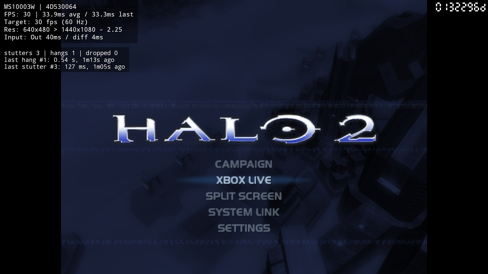
</p>

HakuXP is a fork of [hakuX](https://github.com/rfandango/hakuX). The core is
hakuX's: the game's x86 code runs on a JIT (a FEX fork) under a
reimplementation of the Xbox kernel, the game's own Direct3D push buffer is
decoded from the NV2A into Vulkan, and the MCPX APU is ported from xemu. No
BIOS, MCPX ROM or hard disk image is needed.

What HakuXP adds is the work around that core:  
Tools that show what a game is doing, runs that can be repeated frame for frame,  
and a written record of every test on the device.  
Every change since hakuX v1.3.0 is documented here
[CHANGELOG.md](CHANGELOG.md).


## Compatibility

Compatibility comes first in HakuXP.
([docs/AUTOMATION.md](docs/AUTOMATION.md)) is to run a test set of about
1,100 titles on screen, group the ones that fail by what they have in
common, and fix first what stops the most games.

All games to start with are ran in 4:3 (weather that be 640x480 or lower)  
Then the emulator scales that output to your native screen resolution  
`640x480 > 1440x1080 - 2.25` 
This is a diff scale of 2.25. if the intramural game resolution is edited or scale it will show here  
`1280x960 x2 > 1440x1080 - 1.13`  
a 125% increase vs just 12.5%. Its still hard on the emulator, but not the game as much so its a bit easier to debug. We can work on up-scaling and resolution mods later once the games are running well.

Each test is written down in [docs/testing/](docs/testing/): the title ID
and XMID, the image and its XBE hash, the device, GPU driver and APK, what
was seen before and after, and what was not checked. A fix counts when it
is seen working on the device; a passing host test is not enough.

### Before and after

<table>
  <tr>
    <th>Before</th>
    <th>After</th>
  </tr>
  <tr>
    <td>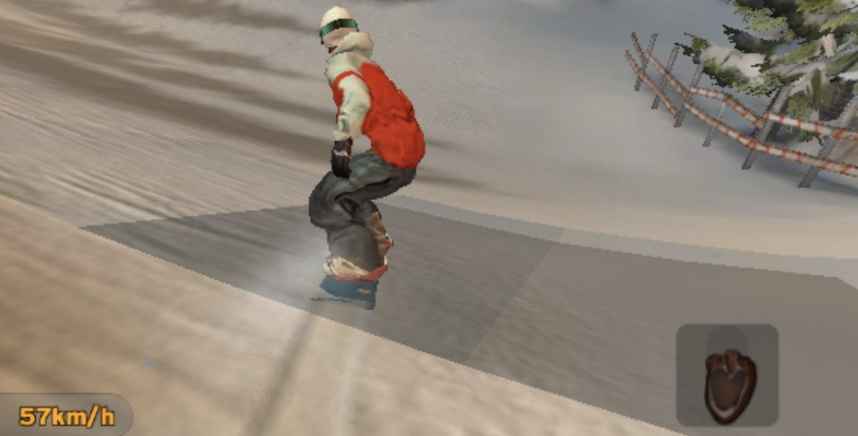</td>
    <td>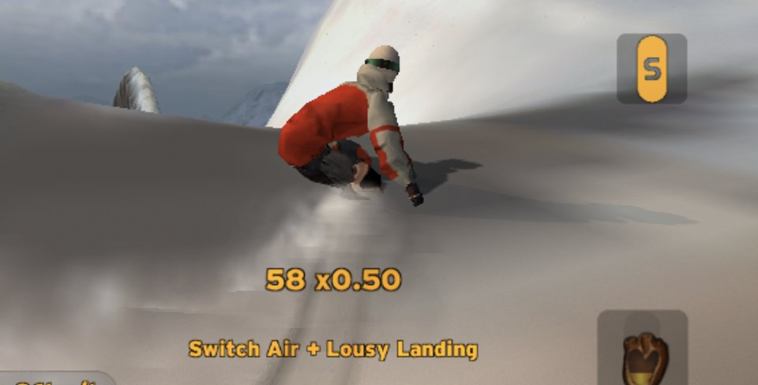</td>
  </tr> 

<tr>  
    <th>Reference</th>
    <th>Debug</th>
</tr>  
<tr>
    <td>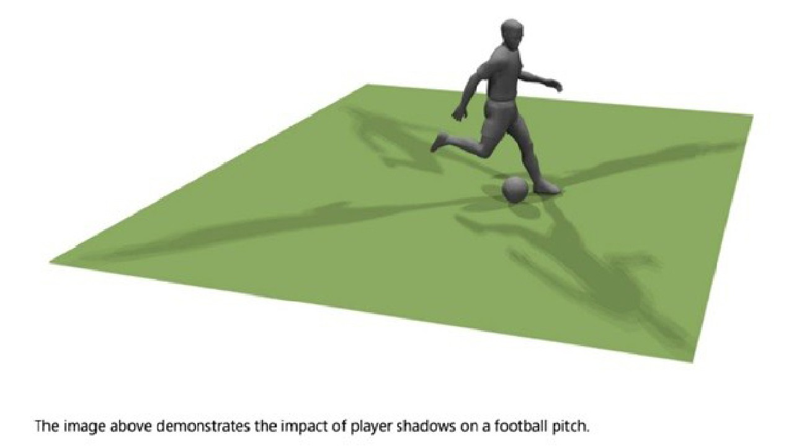</td>
    <td>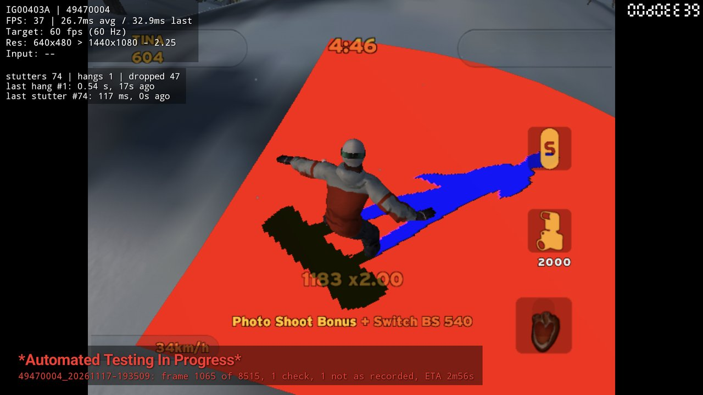</td>
</td>
</tr>

</table>

**TransWorld Snowboarding.** Each light drew a dark square on the snow
around the rider instead of his shadow. The game renders the rider into a
24-bit float depth map per light, then compares the snow's depth with it;
the compare read those maps at the 16-bit float format's range and cut the
snow's depth at 10,000,000. Both are F24's own now, and the rider casts a
shadow per light, shaped like him. Other depth formats compare as before.
([test record](docs/testing/2026-11-18-tws-shadows.md))

### Sample of some fixes made in HakuXP

- **Halo: Combat Evolved** no longer closes the app when a saved game loads.
  Its Direct3D needs pages below 0x61000, and the emulated kernel's own
  area left only one there. Played from the save for 4.5 minutes at about
  30 fps. ([record](docs/testing/2026-11-15-halo-visibility-test.md))
- **Midtown Madness 3** boots. Its certificate asks for the disc's security
  sector; the emulated drive now builds one and signs it with HakuXP's own
  key. ([research](docs/research/2026-11-15-security-sector-check.md))
- **TransWorld Snowboarding**: the shadows above, and playbook replays
  without 100 ms stutters (about 51 fps before, 59.5 after).
- **Dennou Taisen - DroneZ** no longer stops drawing after its nickname
  screen: `NtYieldExecution` now yields to lower priorities.
  ([record](docs/testing/2026-11-16-dronez-yield.md))
- **Fallout 2 CE** (homebrew) gets past its first RDMSR.
  ([record](docs/testing/2026-11-16-fallout2ce-rdmsr.md))
- **RalliSport Challenge 2**: the cars no longer turn white after about six
  stages; old reflection cubes are freed. Host-tested only so far.
- **Frame pacing**: the emulated vblank follows the screen only when the
  screen's vsync is real and within 0.5% of the console's. On a device that
  hands apps a timer's vsync (about 61.5 Hz on an Odin2) it ran 2.6% fast.
- **A game's crash stops the game, not the app.** An unhandled page fault
  in the title shows "The game stopped" with the address, and Export logs
  saves the details. ([record](docs/testing/2026-11-16-title-crash-stops-the-game.md))

HakuXP keeps every game fix in hakuX up to v1.3.0.

<p align="center">
  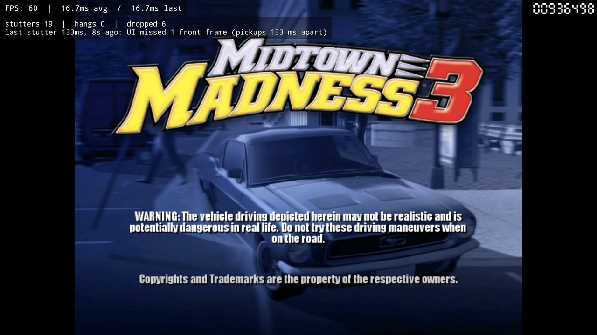
  <br>
  <sub>Midtown Madness 3 went back to the library before the security sector fix.</sub>
</p>

### Where things stand

- The second sweep (2026-11-16, headless, before runs moved on screen)
  booted 39 titles for 90 seconds each on Turnip: 38 ran the whole 90
  seconds and 37 drew correctly. That measures first boot, not whether a
  game can be finished.
  ([record](docs/testing/2026-11-16-sweep-2.md))
- Open leads, such as Xbox Music Mixer halting at boot, Re-Volt staying on
  its title screen and slow load screens, are in [TODO.md](TODO.md) under
  "Game compatibility leads".
- All HakuXP device testing so far is on one device, below. Other devices
  have not been tested with HakuXP's changes.

## Test devices  
`TODO: Move this to its own page when we get more devices`

| Device | Name | Specs | Games tested |
| --- | --- | --- | --- |
| 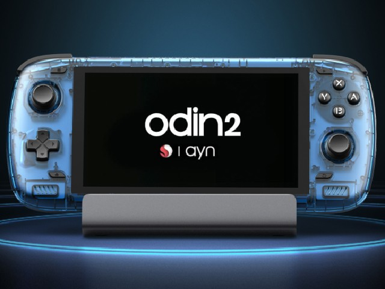</img> | **AYN Odin2** | CPU: QCS8550 (Snapdragon 8 Gen 2 class), Adreno 740<br>RAM: 16 GB<br>Screen 6' 1920 x 1080<br>Android 13<br>GPU Driver: Turnip (PurpleVK 26.3.0-devel) | `43 / 2179` |

Games tested counts releases (XMIDs) out of the 2,179 in
[MobCat's original Xbox game list](https://www.mobcat.zip/XboxIDs/). Full
specs as the device reports them, every game tested with its title ID, XMID
and result, and how to add a device: [docs/DEVICES.md](docs/DEVICES.md).

## Custom guide menu

Bringing the feasters of an xbox 360 style guide menu to og xbox emulation.  
The Back key, a controller's guide button or the on-screen menu button
opens the guide menu over the paused game. It shows the game's title image, name,
title ID and XMID, how long it has been playing and the emulation count,
in four tabs switched with LB and RB.

<p align="center">
  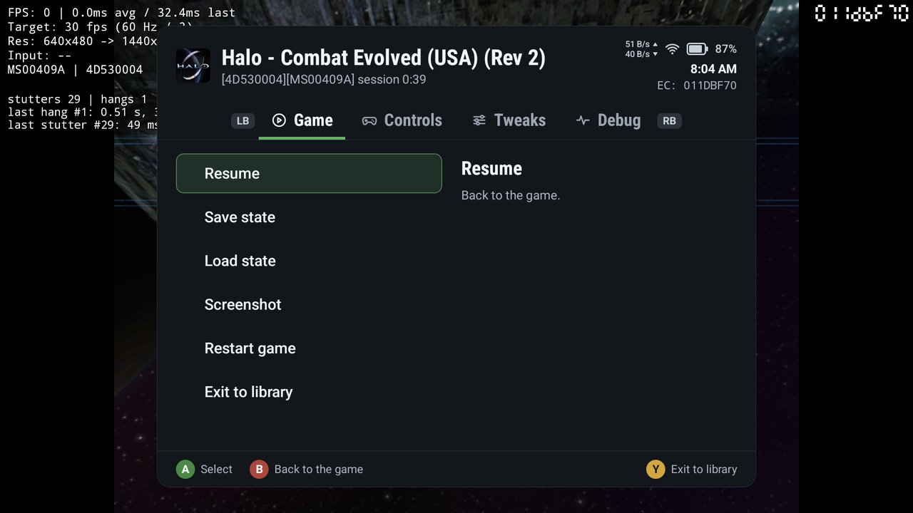
</p>

| Tab | What it has |
| --- | --- |
| Game | Resume, save states as a list with pictures and sizes, load, screenshot, restart, exit |
| Controls | Controllers, on-screen controls and their layout, rumble strength (0.00 to 2.00) |
| Tweaks | Mods and cheats on or off, render scale, aspect ratio, GPU driver |
| Debug | The overlay's switches, Mark log, Playbooks |

It works with a controller: D-pad or stick to move, A to select, B back to
the game, Y to exit to the library, X to delete a save state.

## Debugging tools

<table>
  <tr>
    <td width="50%">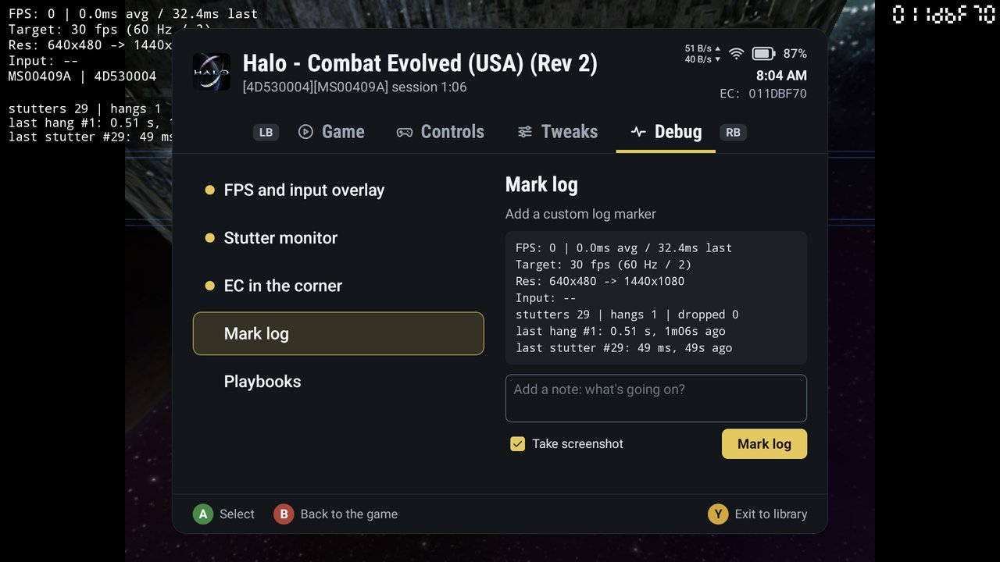</td>
    <td width="50%"></td>
  </tr>
  <tr>
    <td><sub><b>Mark log</b>: a note and a screenshot into the log at this moment, like a stream marker.</sub></td>
    <td><sub><b>A shader debug view</b> (<code>debug.hakux.psdbg=17</code>): red where the light's depth map is, blue where the compare puts the snow in shadow. This is how the shadow bug above was found.</sub></td>
  </tr>
</table>

Settings > HakuXP > Debug > **Debugging** turns all of these on or off at
once. Off (release builds start that way), the debug service doesn't run,
the overlays and playbooks are off, the Debug tab's other rows are grayed
out and the guide has no Debug tab. Debug builds start with it on.

| Tool | What it does |
| --- | --- |
| **XBDM Implantation** | Settings > HakuXP > Debug > XBDM live logging runs a log server for the whole app in its own process, so it keeps running when a game crashes. It carries the launcher, SDL, Java and native logs and the game's own `DbgPrint` output with thread IDs, to original Xbox log clients such as xbdlog. Logging only so far: no memory, register or breakpoint commands. Off by default, and on the device's loopback unless you allow LAN connections. <br> This XBDM implantation means you can use your favort og xbox debugging tools to debug games and the emulator itself, the same way you always have. |
| **`debug.bat`** | Records a session on the PC over ADB (the XBDM log and a separate copy of the app's Android log) and puts the device's settings back when it stops. |
| **`summary.bat`** | A few lines per game launch from a capture: image, title ID, device, GPU driver and its build, how far boot got, how it ended, missing kernel functions, unanswered disc commands, frame rate. |
| **Emulation count** | Every native log line starts with the count of emulated kernel calls in hex (`[0001A2B3]`), and the overlay stamps the same count in the frame's corner, so any screenshot can be found in the log. It never goes back, even when a save state loads. |
| **The overlay** | Frame rate and frame times, target rate, render resolution, input latency (`Input: Out 41ms / diff 3ms`), the game's XMID and title ID, and a stutter monitor counting stutters, hangs and dropped frames, each numbered as in the log. |
| **Mark log** | From the guide's Debug tab: a note, and a screenshot if ticked, into the log. With `debug.bat` running, the picture lands in `build\screenshots`, named by date, emulation count and note. |
| **`screenshot.bat`** | The device's screen as a PNG on the PC. |
| **Wireless debugging** | Settings > HakuXP > Debug > Wireless debugging shows whether Android's Wireless debugging is on and the address a PC connects at. `wireless.bat` pairs once; after that `install.bat` and `debug.bat` work over Wi-Fi, no cable. It can keep the screen on while debugging. |
| **What a run ran on** | Each game logs the device, SoC, Android build, RAM and the CPU features the JIT uses, so results can be compared across devices. |
| **Shader debug views and knobs** | `debug.hakux.*` properties switch debug views, frame dumps and traces on a running game; `tools/native/knobs.py --md` lists every one, and every `NC_*` variable, from the source. |

Debug APKs also carry the Khronos validation layer, and RenderDoc can be
added (see [android/app/src/debug/jniLibs/arm64-v8a/README.md](android/app/src/debug/jniLibs/arm64-v8a/README.md)).
How these fit together is in [docs/DEBUGGING.md](docs/DEBUGGING.md).

## Testing tools

<p align="center">
  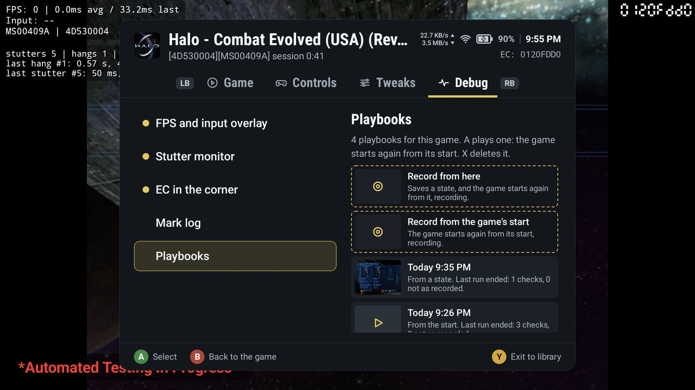
</p>

**Playbooks: the same run every time.** Record the controller from the
guide (Debug > Playbooks: from here, which saves a state first, or from the
game's start) and play it back: the same presses at the same frames, with
the recorded controller as the only input. Checkpoints every 600 frames and
at each Mark log keep the frame's picture and a signature of it, and a
replay says which checkpoints look as recorded, so a fix can be told from a
lucky run.

- **Repeatable runs.** While a playbook plays or records, the guest's clock
  moves with the frames, the vblank comes at the game's own waiting point,
  and the GPU, sound and controller run in step with it. The emulator is
  not fully deterministic yet: a game that times itself by the clock can
  still drift, and the checkpoints show where.
- **Written by hand, too.** Playbooks are text: frame numbers, buttons,
  sticks and triggers, and `save` and `load` lines for save states partway
  through. See [docs/PLAYBOOKS.md](docs/PLAYBOOKS.md).
- **`playbook.bat`** on the PC plays a playbook on the device's screen and
  waits for its verdict, starts and stops recordings, adds marks, pulls runs
  to `build\playbooks`, pushes playbooks and compares runs checkpoint by
  checkpoint.
- **Automated Testing In Progress.** While the PC drives the device or a
  playbook plays, the game shows that line in red with the playbook's
  progress and an ETA, and keeps the screen on. Games run on screen in the
  app, never headless in the background: `xboxrun` refuses to run on
  Android.
- **State IDs.** Every save state has an ID,
  `<title ID>_<XMID>_<date-time>`, and a small `.info` file saying what it is,
  so a playbook can name the states it uses.
- **Host tests.** `test.bat` builds and runs the native host tests (XBE and
  disc parsing, push buffers, shaders, swizzling, the APU, playbooks, the
  deterministic clock and events). `test.bat jvm`, `state`, `xbdm` and
  `wireless` run the Android JVM tests, the save state schema locks, the
  XBDM transport and the PC tools against a simulated adb.

The runbook for testing a game on the device, and for writing the result
down, is [docs/TESTING-GAMES.md](docs/TESTING-GAMES.md).

## Also new in the app

<table>
  <tr>
    <td width="50%">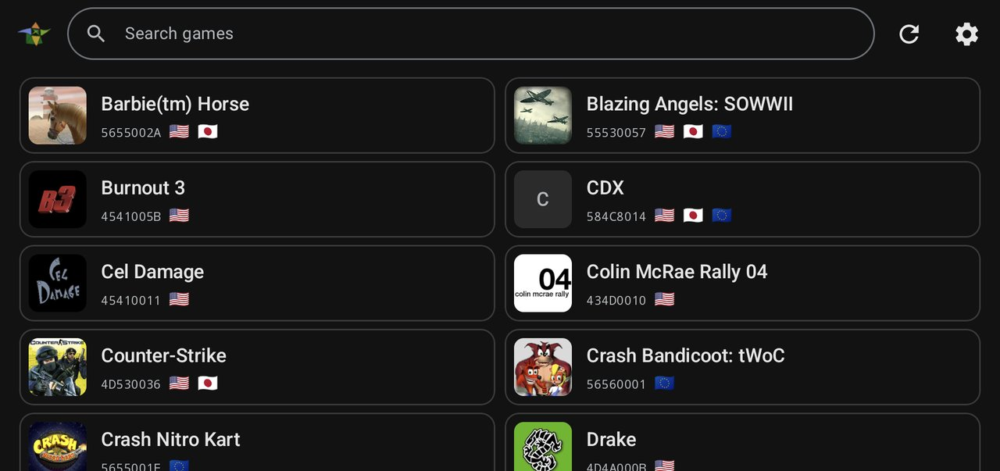</td>
    <td width="50%">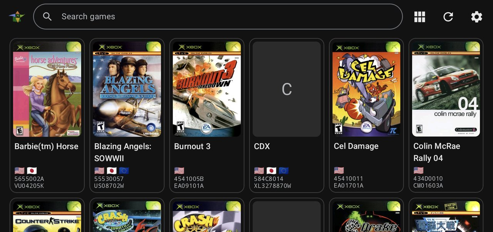</td>
  </tr>
  <tr>
    <td><sub><b>Icons view</b>: each disc's own title image, its title ID and regions.</sub></td>
    <td><sub><b>Covers view</b>: front covers by the disc's XMID, with its regions, title ID and XMID.</sub></td>
  </tr>
</table>

- **Library views.** The button beside Refresh switches between Icons and
  Covers, and the app remembers the choice. Covers come from
  [MobCat's original Xbox game list](https://github.com/MobCat/MobCats-original-xbox-game-list)
  by the disc's XMID, downloaded once and kept in the app's cache; a disc
  pressed with a different version than its XBE carries gets its game's
  nearest one. Only the Covers view goes online.
- **The HakuXP name and icon**, and the icon on the library's dashboard
  button.
- **Settings in two bars of tabs.** The top bar picks HakuXP (the app:
  General, Graphics, Controls, Debug) or Console (the emulated Xbox: System,
  Video, Network, EEPROM). Each area remembers its tab and scroll position.
- **A console of its own from the first start.** The app makes the
  console's EEPROM before any game, laid out like a real v1.0 console's: a
  serial number in the factory's pattern, a MAC address in Microsoft's
  block, and its own random hard disk key. Console > EEPROM shows it, read
  only.
- **The console's time zone follows the phone's**, daylight saving
  included, so a game's local time and the dashboard's clock change with it.

## Requirements

- An arm64 Android device with Vulkan. Custom Turnip drivers can be loaded
  for Adreno GPUs; Mali, Xclipse and PowerVR are experimental (from hakuX
  v1.1.0).
- Your own game images (ISO or XISO), dumped from discs you own.

No BIOS, MCPX ROM or hard disk image is needed. HakuXP doesn't include any
copyrighted Xbox software.

## Building

HakuXP's build scripts are for Windows; the output is an Android APK, not
a Windows emulator. See the [Windows build guide](docs/BUILDING.md), and
[android/README.md](android/README.md) for upstream's build notes.

From the project root in Command Prompt:

```bat
setup.bat
build.bat doctor
test.bat
build.bat
```

In PowerShell, prefix commands with `.\`, for example `.\build.bat`.
`install.bat` installs the last debug APK on the test device, over Wi-Fi or
USB.

HakuXP installs as `zip.mobcat.hakuxp` (debug builds
`zip.mobcat.hakuxp.debug`), next to hakuX. For a release, make the signing
key once with `build.bat keystore`, then `build.bat release`; see
[Release builds](docs/BUILDING.md#release-builds). There is no published
release yet.

## Documentation

- [Project overview](docs/PROJECT.md): architecture, source map, tests and
  debugging resources.
- [Debug harness](docs/DEBUGGING.md): XBDM log capture with `debug.bat`,
  the implemented protocol, module boundaries and validation.
- [Testing a game](docs/TESTING-GAMES.md): the runbook for a device test,
  in the app or with a playbook, and how to record the result.
- [Playbooks](docs/PLAYBOOKS.md): record a controller run and play it back
  the same way each time, on screen; the format, hand-written examples,
  save states and state IDs, and reading the results.
- [Automation](docs/AUTOMATION.md): the plan for testing the whole test
  set, wireless debugging and remote control over XBDM.
- [Test devices](docs/DEVICES.md): each device's specs and the games
  tested on it.
- [Test records](docs/testing/): one per device test, with what was and
  wasn't checked.
- [Backlog](TODO.md): compatibility leads, fork setup and unfinished
  upstream work.
- [Source TODO/FIXME inventory](docs/TODO-INVENTORY.md): every marked
  source line.
- [Historical handoff](HANDOFF.md): upstream research. Its devices and
  paths belong to the original author.

## Credits

HakuXP stands on [hakuX](https://github.com/rfandango/hakuX) by rfandango,
its FEX fork, the MCPX APU code from [xemu](https://xemu.app), and the
third-party components listed in [LICENSE](LICENSE).

## License

HakuXP, like hakuX, is free software under the GNU General Public License,
version 3 or later ([COPYING](COPYING)): anyone who distributes it, or a
work based on it, must make the complete source available under the same
license. The code ported from xemu (the MCPX APU) and the third-party
components keep their own licenses, listed in [LICENSE](LICENSE) and
[licenses/](licenses/).

## Notes

- HakuXP is not affiliated with Xbox, Microsoft, or the official hakuX project.  
(Fine I'll fork my own emulator, with blackjack and hookers!)
- Game images, console keys and private debug captures are not part of
  this source tree.
