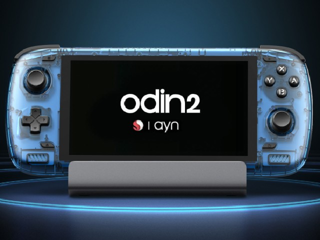

# Test devices

The devices HakuXP has been tested on, what they are, and which games ran
on each. A result holds for the device, Android build and GPU driver it was
seen on; it says nothing about another device until someone runs it there.
How a test is run and written down: [TESTING-GAMES.md](TESTING-GAMES.md).
Each test's own record is in [testing/](testing/).

| Device | Name | Specs | Games tested |
| --- | --- | --- | --- |
|  | **AYN Odin2** | QCS8550 (Snapdragon 8 Gen 2 class), Adreno 740<br>CPU: 1x Cortex-X3 3.19 GHz, 2x Cortex-A710 and 2x Cortex-A715 2.80 GHz, 3x Cortex-A510 2.02 GHz<br>RAM: 16 GB (14.9 GiB to Android)<br>Screen: 6 in, 1920 x 1080<br>Android 13 (`Odin2_V1.0.0.380_20250815_111346_user`)<br>GPU driver: Turnip (PurpleVK 26.3.0-devel); Qualcomm's own to compare | [`43 / 2179`](#games-tested-on-the-odin2) |

**Games tested** counts releases (XMIDs) tested on the device, out of the
2,179 releases in the owner's title ID list
([mobcat.zip/XboxIDs](https://www.mobcat.zip/XboxIDs/), database of
2026-06-07). Each release counts once, however it was tested; the tables
under each device say how. Two of the Odin2's 43 aren't in the list:
Fallout 2 CE, a homebrew, and Re-Volt, never released.

## Adding a device

- **Photo:** `docs/images/devices/<device>.jpg`, about 600 px wide, the
  device alone on a plain background. Your own photo, not a store's.
- **Specs:** as the device reports them, not a spec sheet. Each game
  launch logs them, and `summary.bat` prints them from a `debug.bat`
  capture:

  ```
  device: AYN Odin2 (kalama) | SoC QTI QCS8550 (kalama) | Android 13 (API 33), Odin2_V1.0.0.380_20250815_111346_user | RAM 14.9 GiB
  cpu: 8 cores: 1x Cortex-X3 3.19 GHz, 2x Cortex-A710 2.80 GHz, 2x Cortex-A715 2.80 GHz, 3x Cortex-A510 2.02 GHz | atomics lrcpc ilrcpc flagm flagm2
  ```

  and the GPU driver's `vk: driver "..." (id N)` line (18 is Turnip, 8
  Qualcomm's own). Screen size and RAM as sold may come from the maker.
- **Games tested:** the releases with a record in [testing/](testing/) for
  this device, by title ID and XMID, listed under the device; the table
  shows their count over the list's total (`43 / 2179`). Count a release
  once, however many times it ran.

## AYN Odin2

The only test device so far (since 2026-11-15), reached over Wireless
debugging (`wireless.bat`). Its games are on its SD card.

Known quirks:

- **Synthetic vsync.** With the screen on, Android can hand apps a
  timer's vsync (about 61.5 Hz, `app: state=SyntheticVSync` in `dumpsys
  SurfaceFlinger`) instead of the panel's 60 Hz. The emulated vblank only
  follows a regular vsync within 0.5% of the console's since 2026-11-17;
  check for it before reading anything into frame pacing. Sleeping and
  waking the device cleared it once (2026-11-17).
- **Qualcomm's driver.** RalliSport Challenge 2 is black on it, and sweep
  1's black or one-colour frames were the driver's. Test on Turnip unless
  the driver is the question.

### Games tested on the Odin2

**Played on screen**, in the app or with playbooks, on Turnip:

| Game | Title ID | XMID | How | What was seen | Record |
| --- | --- | --- | --- | --- | --- |
| Halo: Combat Evolved (USA) (Rev 2) | `4D530004` | `MS00409A` | In the app; playbooks | Plays from its save at about 30 fps since the kernel-area fix (it closed the app before). The light shaders are wrong | [save](testing/2026-11-15-halo-visibility-test.md), [stutter](testing/2026-11-17-halo-attract-stutter.md), [playbooks](testing/2026-11-16-playbooks-first-device-run.md) |
| Midtown Madness 3 (USA) | `4D53002A` | `MS04204A` | In the app | Boots since the security sector fix (back to the library before). 60 fps in menus, 30 in play, slow load screens | [research](research/2026-11-15-security-sector-check.md), [first run](testing/2026-11-15-first-device-run.md) |
| RalliSport Challenge 2 (World) | `4D530039` | `MS05701W` | In the app, 93 minutes | 58.5-59.7 fps, no fault. The cars turned white after six stages (fixed, host-tested only) | [record](testing/2026-11-16-rallisport-long-play.md) |
| Soulcalibur II (USA) | `4E4D0003` | `NM00301A` | Playbooks | Two replays match each other at every checkpoint, idle and with the owner's recorded fight, at 60 fps | [record](testing/2026-11-17-playbook-determinism.md) |
| TransWorld Snowboarding (USA) | `49470004` | `IG00403A` | Playbooks | Shadows fixed (squares before); replays at 59.5 fps without 100 ms stutters | [record](testing/2026-11-18-tws-shadows.md) |

**First boot, 90 seconds**, headless on Turnip (sweep 2, 2026-11-16,
before games moved on screen only): a scripted Start or A every 5 s, no
sound, nothing past 90 s. "Draws" means its logos, video, menus or play
looked right in the three captures. [Record](testing/2026-11-16-sweep-2.md).

| Game | Title ID | XMID | First boot |
| --- | --- | --- | --- |
| Barbie Horse Adventures: Wild Horse Rescue | `5655002A` | `VU04205K` | Draws |
| Battlefield 2: Modern Combat | `45410062` | `EA09801A` | Draws |
| Blazing Angels: Squadrons of WWII | `55530057` | `US08702W` | Draws; slow load (0.4 fps) |
| Burnout 3: Takedown | `4541005B` | `EA09101A` | Draws |
| Cel Damage | `45410011` | `EA01701A` | Draws; relaunches |
| Colin McRae Rally 04 | `434D0010` | `CM01603A` | Draws |
| Counter-Strike | `4D530036` | `MS05401K` | Draws; relaunches |
| Crash Bandicoot: The Wrath of Cortex | `56560001` | `VV00101E` | Draws |
| Crash Nitro Kart | `5655001F` | `VU03102E` | Draws |
| Dennou Taisen: DroneZ | `4D440003` | `MD00303J` | Draws, since the yield fix ([record](testing/2026-11-16-dronez-yield.md)) |
| Fallout 2 CE (homebrew) | `FFFF0002` | `FFFF00200` | Draws, at 8.4 fps, since the RDMSR fix ([record](testing/2026-11-16-fallout2ce-rdmsr.md)) |
| Forza Motorsport + Xbox Live Arcade | `584C8014` | `XL3278870W` | Draws; its menu relaunches into Forza Motorsport (`4D53006E`); slow load (2.7 fps) |
| Fuzion Frenzy | `4D530002` | `MS00201A` | Draws |
| Godzilla: Destroy All Monsters Melee | `49470039` | `IG05702W` | Draws |
| Gui Yi | `58500001` | `XP00101J` | Draws |
| Halo (Japan) | `4D530004` | `MS00406J` | Runs, black at every capture |
| Halo 2 | `4D530064` | `MS10003W` | Draws |
| Hello Kitty: Roller Rescue | `58500004` | `XP00402E` | Draws |
| Juiced | `545100EF` | `TQ23901W` | Draws |
| Metal Wolf Chaos | `46530006` | `FS00601J` | Draws |
| MX SuperFly | `54510010` | `TQ01601A` | Draws |
| MX vs. ATV Unleashed | `545100ED` | `TQ23701K` | Draws |
| NASCAR Heat 2002 | `49470009` | `IG00901A` | Draws; relaunches |
| Petit Copter | `41510001` | `AQ00101J` | Draws |
| Phantom Dust | `4D530046` | `MS07003A` | Draws |
| Re-Volt (unreleased) | `584C0001` | `XL00100` | Runs, stays on its title screen |
| Shikigami no Shiro II | `4B490002` | `KI00201J` | Draws |
| Shinchou Mahjong | `45460001` | `EF00101J` | Draws |
| Smashing Drive | `4E4D0001` | `NM00102A` | Draws |
| Star Wars: Battlefront II (Rev 1) | `4C41001A` | `LA02604W` | Draws |
| The Matrix: Path of Neo | `4947007C` | `IG12401K` | Draws |
| The Simpsons: Hit & Run | `56550015` | `VU02101K` | Draws |
| Tenerezza | `41500001` | `AP00101J` | Draws |
| TOCA Race Driver 2 | `434D0011` | `CM01702A` | Draws |
| TransWorld Snowboarding | `49470004` | `IG00403A` | Draws; relaunches; slow load (6.9 fps) |
| Unreal Championship | `49470024` | `IG03605L` | Draws |
| WarPath | `4756000A` | `GV01002W` | Draws; slow load (0.7 fps) |
| Whiplash | `45530011` | `ES01701A` | Draws |
| Xbox Music Mixer | `4D53005A` | `MS09004A` | Halts 0.3 s in, no frame |

Names are from the owner's title ID list, found by XMID, or by the
`default.xbe`'s MD5 where the XMIDs differ; Fallout 2 CE and Re-Volt
aren't in it.

The XMIDs in these tables are the XBE's, as the core logs them (title ID,
certificate version and region). The list keys a release by the XMID
printed on its disc, which is the same for nearly all of them; for a few
the disc was pressed with other details than the XBE carries:

| Game | XBE's XMID | Disc's XMID | `default.xbe` MD5 |
| --- | --- | --- | --- |
| Forza Motorsport + Xbox Live Arcade | `XL3278870W` | `XL02070W` | `BDFC0CCC7CAA68EED3B9C8CAB5F87FC3` |
| Fuzion Frenzy | `MS00201A` | `MS00202A` | `FB56D685565EDECEFF8ED28716399ED8` |
| Xbox Music Mixer | `MS09004A` | `MS09005A` | `E50598FF0F7F2DADEB778FAEDD12FA6C` |

Open leads from these runs are in [TODO.md](../TODO.md), "Game
compatibility leads".
